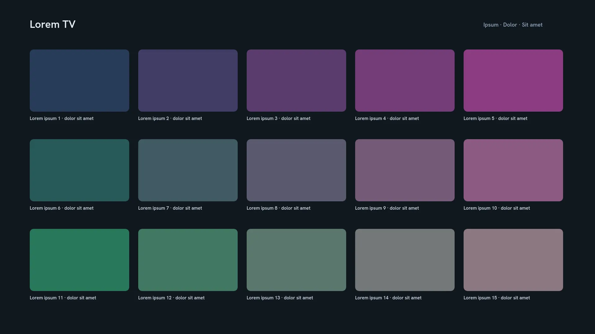
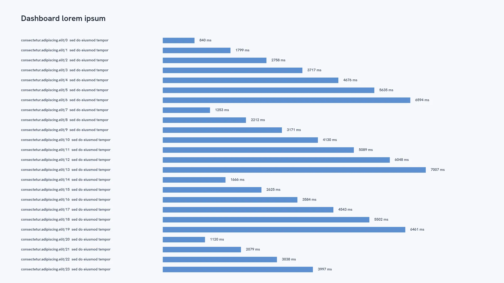

Lorem ipsum dolor sit amet, consectetur adipiscing elit. Each block below shows one moment from two sides.

## An evening

Sed do eiusmod tempor incididunt ut labore et dolore magna aliqua.

{}
{}

Lorem ipsum: the film stops, a friendly character says goodbye, and the screen explains why.
{}
{}

Dolor sit amet: type the parent code with the remote and add fifteen minutes.
{}
{}

Ut enim ad minim veniam, quis nostrud exercitation ullamco laboris nisi ut aliquip ex ea commodo consequat.

{}
{}

{}
{}
Nothing. The daily minutes are spent, so Peke stays on the goodbye screen until tomorrow. Duis aute irure dolor in reprehenderit in voluptate velit esse.
{}
{}

Excepteur sint occaecat cupidatat non proident, sunt in culpa qui officia deserunt mollit anim id est laborum.
